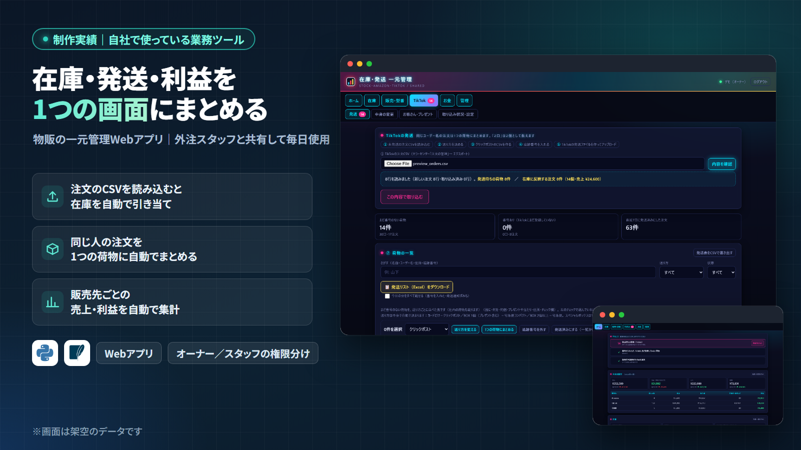
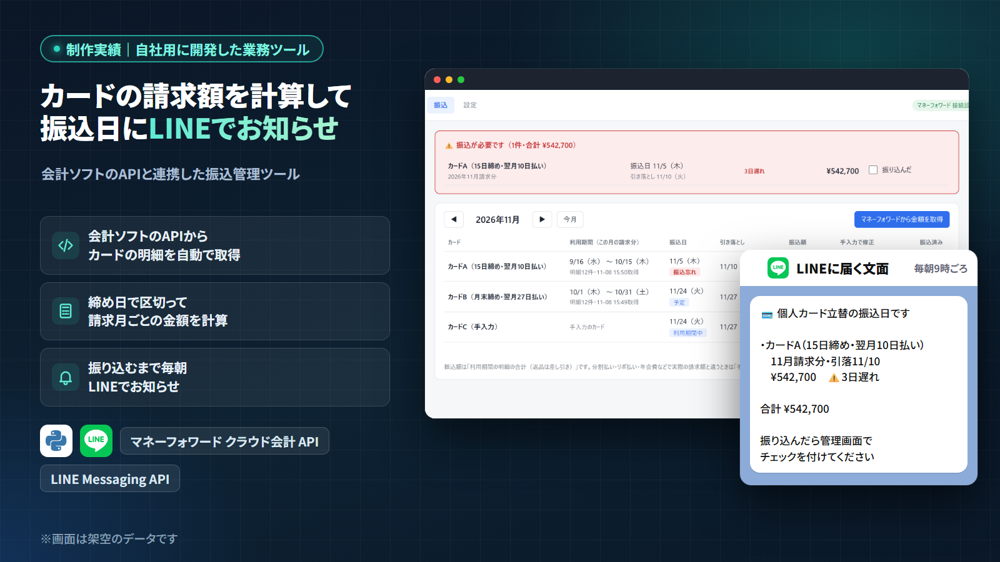
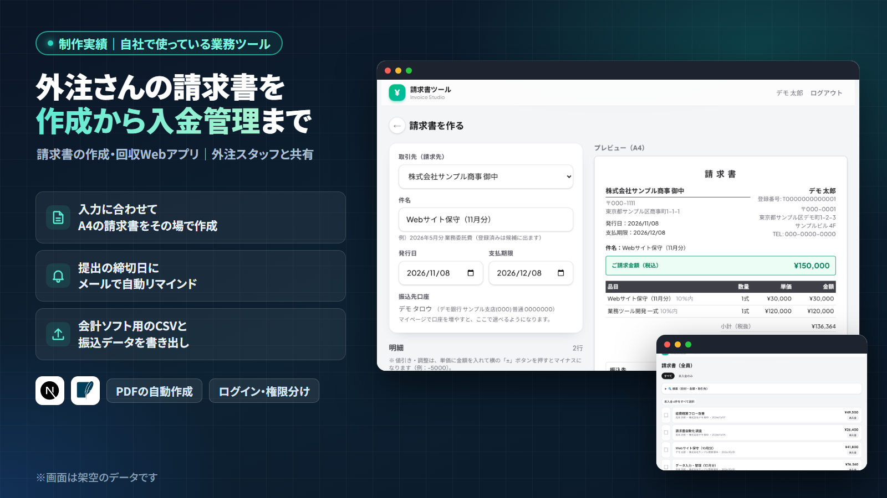
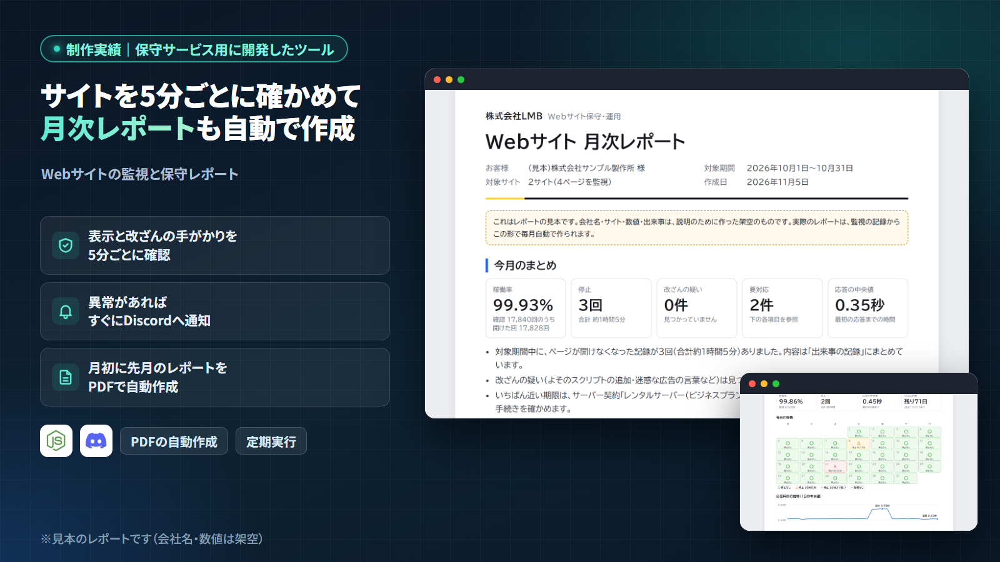
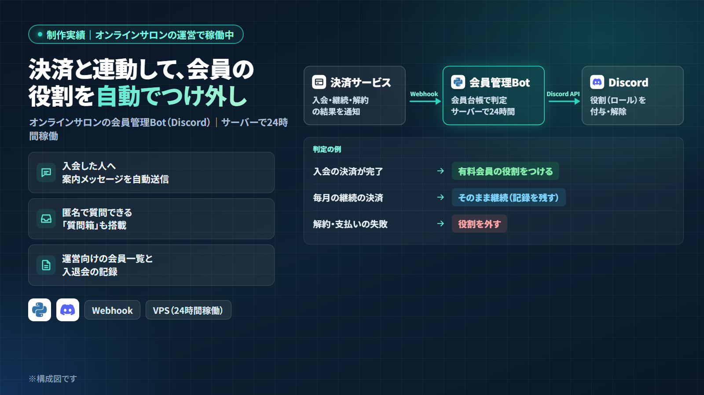

# らんぼ

GAS・Python・生成AIで、手作業を止まらない仕組みにしています。
自分の会社の業務を自作のツールで回しながら、業務の自動化と社内ツールの開発をお受けしています。

## 作ったもの

自社と保守サービスで使っている業務ツールです。画面はすべて架空のデータで、ソースコードは非公開です。

### 在庫・発送・利益の一元管理

注文のCSVを読み込むと在庫を自動で引き当て、同じ人の注文を1つの荷物にまとめ、販売先ごとの売上・利益まで集計するWebアプリです。外注スタッフと共有して毎日使っています。

### 会計ソフトAPI連携の振込管理

会計ソフト（マネーフォワード クラウド会計）のAPIからカードの明細を取り、締め日で区切って請求月ごとの振込額を計算します。振り込むまで毎朝LINEで知らせる仕組みつきです。

### 外注さんの請求書の作成と入金管理

入力に合わせてA4の請求書をその場で作り、提出の締切日にメールでリマインド、会計ソフト用のCSVと振込データも書き出せます。外注スタッフと共有しています。

### サイト監視と月次レポート

Webサイトの表示と改ざんの手がかりを5分ごとに確かめ、異常があればDiscordへ通知。月初には先月のレポートをPDFで自動作成します。

### Discordの会員管理Bot

決済サービスのWebhookを受けて、入会・継続・解約に合わせて会員の役割（ロール）を自動でつけ外しするBotです。オンラインサロンの運営で、サーバー上で24時間動かしています。

## 使っている技術

- 言語・フレームワーク：Python / JavaScript（Node.js・Next.js） / Google Apps Script / PHP / HTML・CSS
- AI：Claude・ChatGPT のAPI、Claude Code
- 連携：会計ソフトのAPI / LINE Messaging API / Discord API / Webhook
- 動かす場所：VPS（Ubuntu・nginx） / Cloudflare / Netlify

## お仕事のご相談

業務の自動化・社内ツールの開発・AI導入のご相談をお受けしています。
「この作業、自動にできる？」というご質問だけでも歓迎です。
